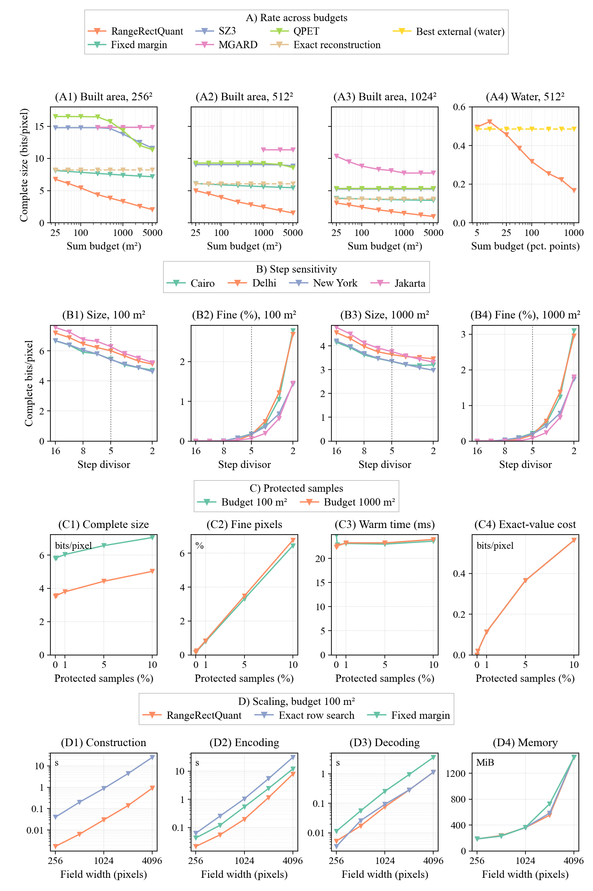
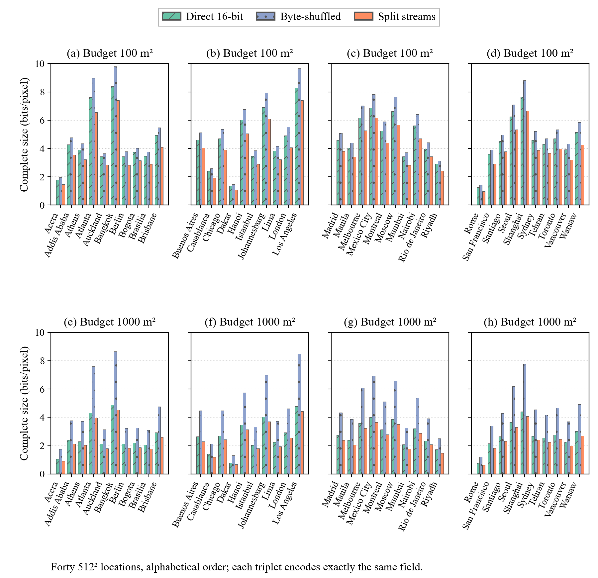
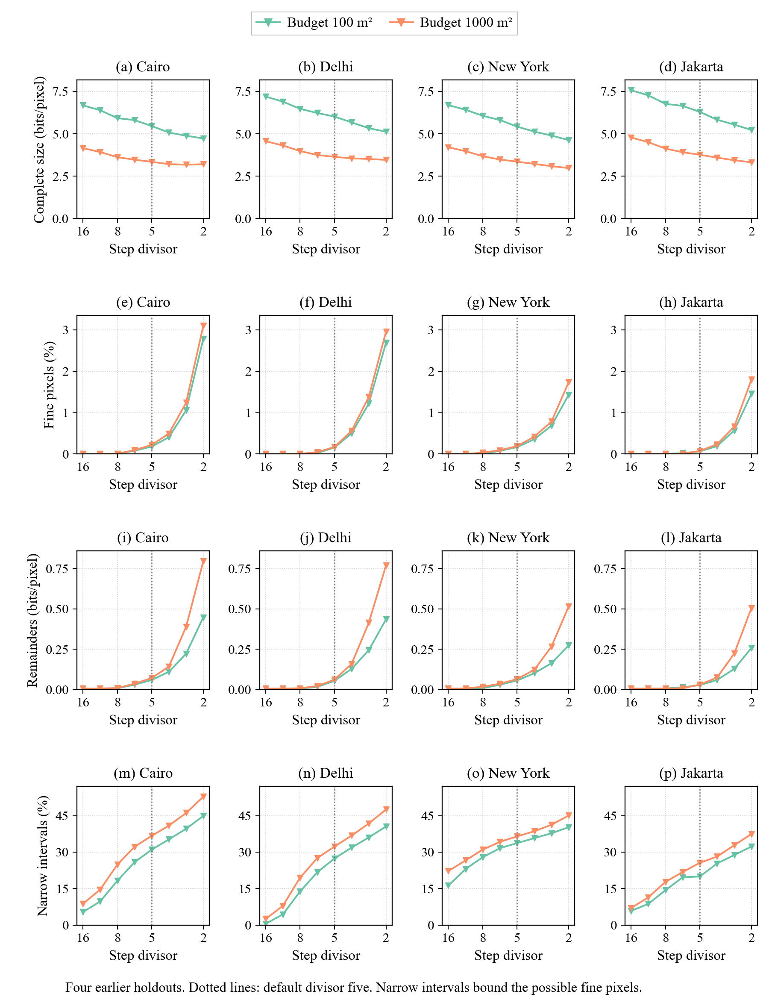
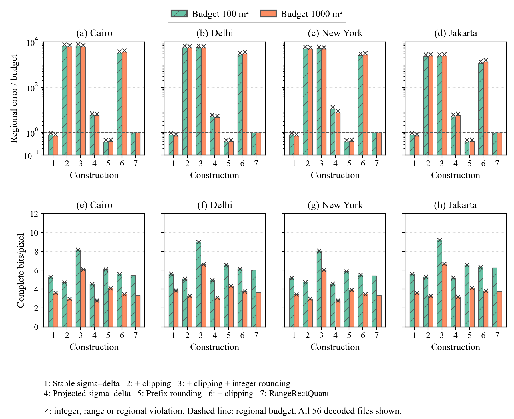
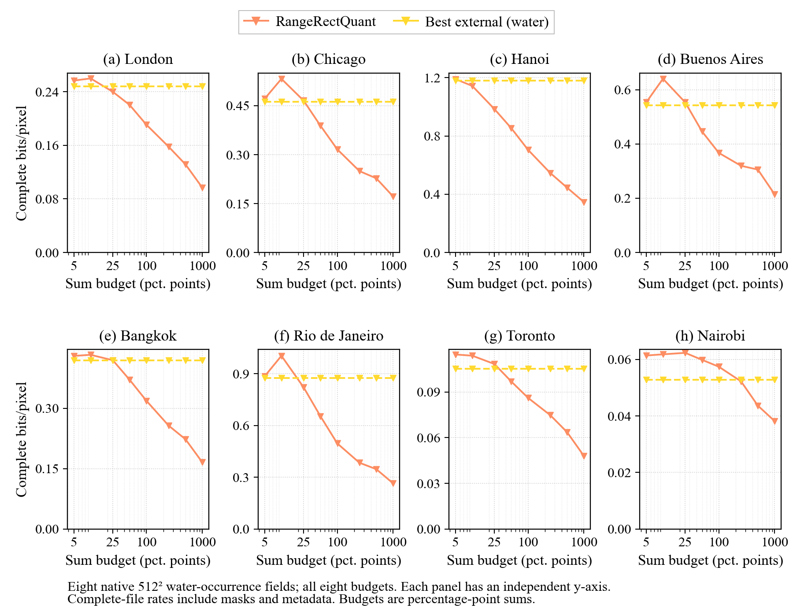
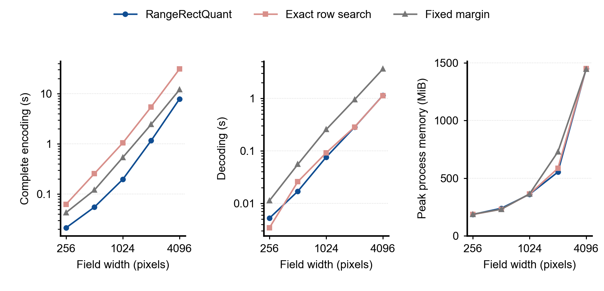
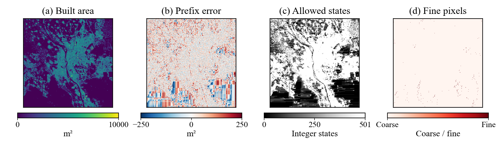

# RangeRectQuant

Compression of bounded integer fields with accurate sums for every rectangle.
This repository contains the code, data, core experimental results, extended
figures, and manuscript.

- **Code and experiments:** `src/`, `experiments/`, `controls/`.
- **Data and results:** `data/`, `results/`.
- **Paper:** [PDF](paper/main.pdf) · [LaTeX](paper/main.tex).
- **Reproduction:** [experiment guide](docs/EXPANDED_REPRODUCIBILITY_20261002.md)
  · [plotting guide](paper/plotting/README.md).

## experiment_atlas.pdf

[View or download the PDF](paper/figures/research/experiment_atlas.pdf). All seven pages are previewed below.

Plotting attribution and licensing are retained in `paper/plotting/`;
upstream data provenance is recorded with the acquisition manifests.
